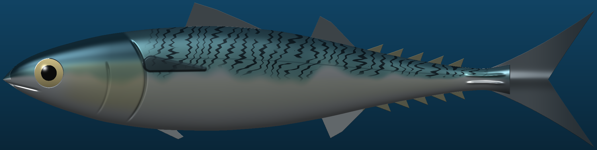
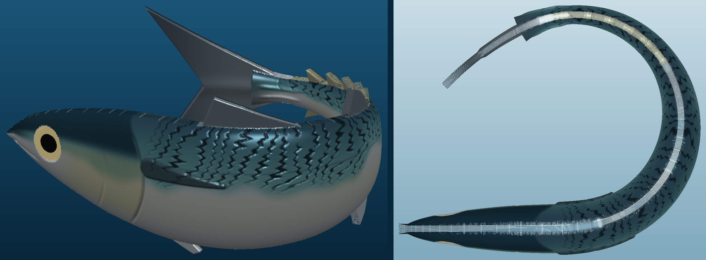

# mackerel – chub mackerel throw flasher

A 3D-printable spearfishing throw flasher shaped and patterned like a Pacific chub mackerel (*Scomber japonicus*).

**Live 3D viewer:** https://kuhfeldrf.github.io/mackerel/

## Two designs

| | Straight flutter | Dead-bait curl |
|---|---|---|
| Shape | 250 × 61 mm, flattened body | Same fish curled 230°, 114 × 94 mm footprint |
| Halves | Left / right flank, 10 mm tall each | Back / belly, split along the lateral line |
| Fall | Flat, fluttering (ballast chamber B) | U-down, head and tail up (ballast chamber C) |
| Pattern | Waterslide decal over chrome | 0.4 mm engraved lines, airbrush + wash |

## Files

- `files/mackerel_flasher_LEFT_half.stl`, `files/mackerel_flasher_RIGHT_half.stl` – straight version
- `files/curled_mackerel_DORSAL_half.stl`, `files/curled_mackerel_VENTRAL_half.stl` – curled version
- `files/chub_mackerel_flasher_decals_and_build_sheet.pdf` – 1:1 decals and build steps
- `files/mackerel_flasher_source.zip` – parametric Python source (change `FL` or `CURL_DEG` and rebuild)

Print in PETG or ASA at 100% infill, flat face down, no supports. Ballast weights are estimates; pool-test before diving.
